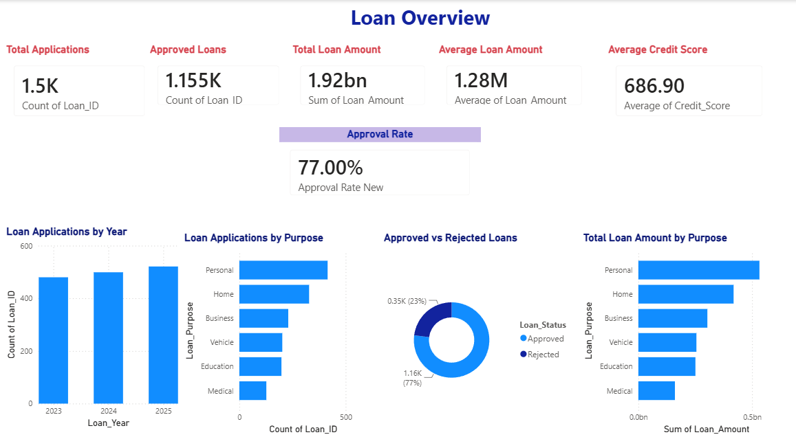
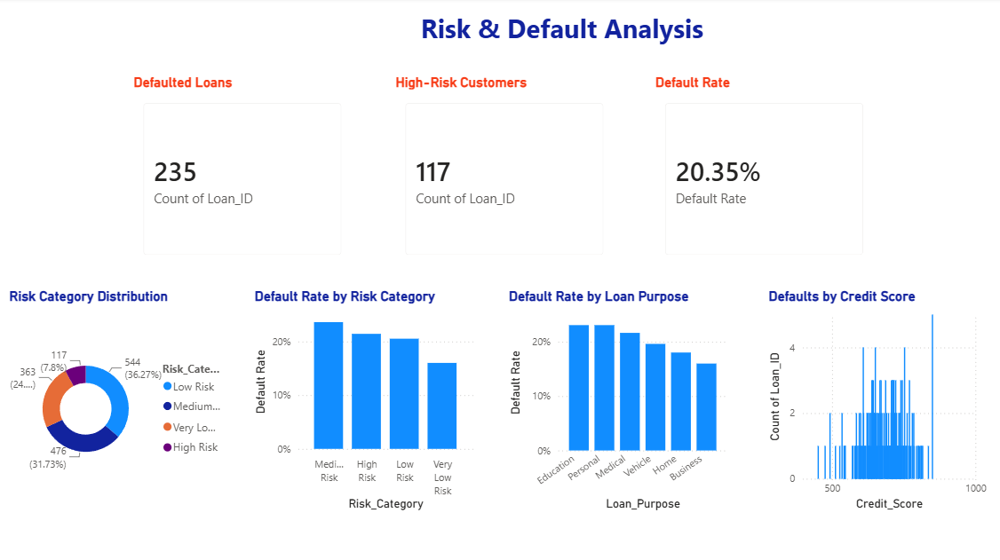
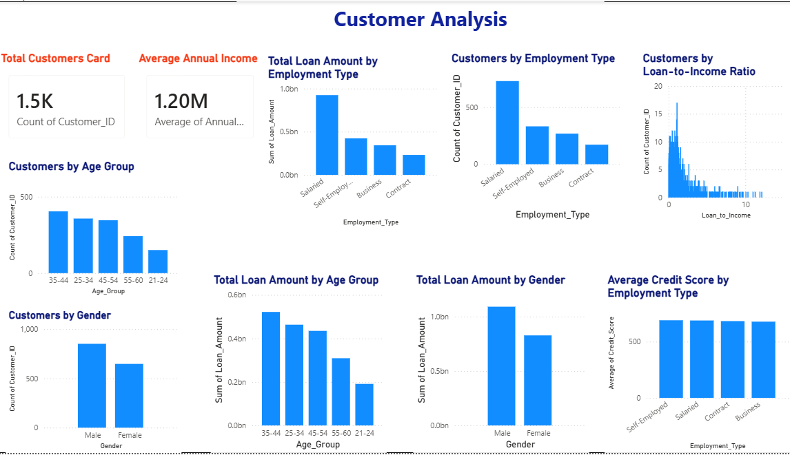

# Banking Loan & Customer Risk Analytics

## Project Overview

This project focuses on analyzing banking loan application data to understand loan approval patterns, loan amounts, and customer credit profiles. An interactive Power BI dashboard is used to present key metrics and support data-driven decision-making.

## Project Objectives

* Analyze total loan applications and approval patterns.
* Understand the distribution of loan amounts.
* Explore customer credit scores.
* Identify patterns in loan application data.
* Present key findings through an interactive dashboard.

## Tools & Technologies

* **Microsoft Power BI** — Dashboard development and data visualization
* **CSV** — Raw and cleaned dataset storage
* **Data Cleaning** — Preparing data for analysis

## Project Workflow

1. Loaded the raw banking loan dataset.
2. Prepared the data for analysis.
3. Used the cleaned dataset to explore loan-related metrics.
4. Created visualizations in Power BI.
5. Presented key metrics through a dashboard.

## Repository Contents

| File                                           | Description                       |
| ---------------------------------------------- | --------------------------------- |
| `Banking_Loan_Customer_Risk_Analytics_Raw.csv` | Original banking loan dataset     |
| `Banking_Loan_Cleaned.csv`                     | Cleaned dataset used for analysis |
| `Banking_Loan_Customer_Risk_Analytics.pbix`    | Power BI dashboard                |

## Dashboard Metrics

The dashboard includes key performance indicators such as:

* Total Loan Applications
* Approved Loans
* Total Loan Amount
* Average Loan Amount
* Average Credit Score
* Approval Rate

## Dashboard Preview

### Page 1

### Page 2

### Page 3

## Business Questions

This project explores questions such as:

* How many loan applications were received?
* How many applications were approved?
* What is the total and average loan amount?
* What does the customer credit score distribution reveal?
* What patterns can help stakeholders better understand the loan portfolio?

## How to Use

1. Download or clone this repository.
2. Open `Banking_Loan_Customer_Risk_Analytics.pbix` in Power BI Desktop.
3. If prompted, update the dataset source path.
4. Refresh the data if required.
5. Explore the dashboard visualizations.

## Skills Demonstrated

* Data cleaning and preparation
* Exploratory data analysis
* Power BI dashboard development
* KPI analysis
* Data visualization
* Business-oriented analytical thinking

## Author

**Kajal Vishwakarma**

B.Tech — Computer Science Engineering
Aspiring Data Analyst
